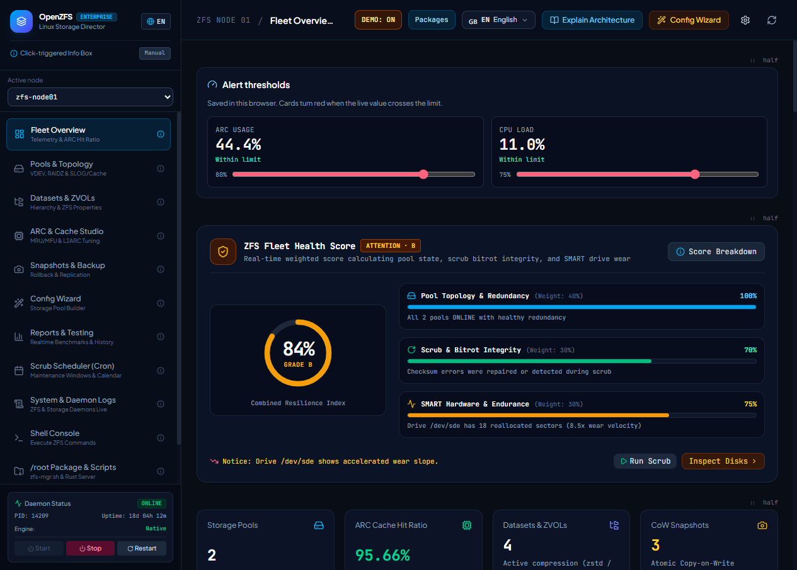

# OpenZFS Enterprise Director

Web panel and command-line tools for OpenZFS on Linux. The project lives in [`openzfs-enterprise-director/`](openzfs-enterprise-director/).



- [Full README and user manual](openzfs-enterprise-director/README.md)
- [Benchmark: panel with and without `rust_engine`](openzfs-enterprise-director/docs/RUST_ENGINE_BENCHMARK.md)

## Quick start

```bash
cd openzfs-enterprise-director
chmod +x start.sh zfs-mgr.sh linux_package/zfs-mgr.sh
sudo ./zfs-mgr.sh start
```

Then open `http://<host>:3000`. The panel has no login screen, so only expose port 3000 on a trusted network.

## License

[MIT](LICENSE)
