# OpenZFS Enterprise Director

Web panel and command-line tools for managing OpenZFS on Linux. The panel is a single Node.js process on port 3000. In **LIVE** mode it runs the host `zpool`, `zfs`, `lsblk`, and `smartctl` commands, locally or on a remote node over SSH. In **DEMO** mode it reads and writes a local JSON state file and does not touch real pools.

## Contents

1. [Overview](#1-overview)
2. [Requirements](#2-requirements)
3. [Installation](#3-installation)
4. [Configuration](#4-configuration)
5. [User manual](#5-user-manual)
6. [Common tasks](#6-common-tasks)
7. [LIVE and DEMO feature matrix](#7-live-and-demo-feature-matrix)
8. [Command-line tools](#8-command-line-tools)
9. [Architecture](#9-architecture)
10. [Development](#10-development)
11. [Troubleshooting](#11-troubleshooting)
12. [Safety](#12-safety)

---

## 1. Overview

What the panel does:

- Shows pool health, vdev topology, disk identity (`lsblk`), SMART data (`smartctl`), host CPU and memory.
- Creates pools with stripe, mirror, raidz1-3, and draid1-3 data topologies, plus SLOG, L2ARC, special, and spare devices.
- Scrubs, trims, and destroys pools. Adds log, cache, special, and spare vdevs to an existing pool. Takes disks offline, online, or removes them.
- Creates, edits, and destroys datasets and zvols.
- Creates, destroys, and rolls back snapshots.
- Reads ARC statistics, changes ARC tunables at runtime, and writes them persistently to `/etc/modprobe.d/zfs.conf`.
- Exports a pool's configuration as a JSON recovery file with the `zpool create` and `zfs create` commands needed to rebuild it.
- Manages other Linux hosts over SSH from the same panel.
- UI in English (default), Spanish, Chinese, Hindi, French, German, Arabic, and Albanian.


Modes at a glance:

| Mode | Where commands run | Changes real storage |
| --- | --- | --- |
| LIVE, local node | This host | Yes |
| LIVE or DEMO, remote SSH node selected | The selected host, over SSH | Yes |
| DEMO, local node | Nowhere; state in `linux_package/python_cli/zfs_state.json` | No (see the ARC note in [Safety](#12-safety)) |

> A fresh clone starts in **LIVE** mode, because the shipped `linux_package/python_cli/demo_mode.json` contains `{"enabled": false}`. If that file is missing, the server starts in DEMO. Check the badge in the header before your first action.

---

## 2. Requirements

| Requirement | Why |
| --- | --- |
| Linux (tested on Ubuntu; Debian works the same way) | Target platform. |
| Node.js 22 or newer, with npm | `npm start` runs `server.ts` with `--experimental-strip-types`. The prebuilt `server.cjs` also runs on Node 18, but 22 is the supported version. |
| Root, or `sudo` | Pool create and destroy, rollback, scrub, ARC tuning and persist, package install, and writing to `/var/lib/zfs-director/`. |
| OpenZFS (`zfsutils-linux`) | `zpool` and `zfs` on every host you manage in LIVE mode. |
| `smartmontools` (`smartctl`) | Disk temperature and SMART health. |
| `nvme-cli` | NVMe disk details, when the host has NVMe disks. |
| `iproute2` (`ss`) | `zfs-mgr.sh` uses it to see whether port 3000 is listening. |
| `python3` | `./zfs-mgr.sh cli` and `./zfs-mgr.sh wizard`. |
| `openssh-client` (director) and `openssh-server` (managed nodes) | SSH nodes. |
| `cargo` (optional) | Only for `./zfs-mgr.sh web-rust`. |

---

## 3. Installation

### 3.1 Prepare a fresh Ubuntu or Debian host

The `nodejs` package in Ubuntu is often older than 22, so install Node.js from NodeSource:

```bash
sudo apt-get update
sudo apt-get install -y ca-certificates curl gnupg git python3 iproute2 \
  zfsutils-linux smartmontools nvme-cli

curl -fsSL https://deb.nodesource.com/setup_22.x | sudo -E bash -
sudo apt-get install -y nodejs

sudo modprobe zfs
node -v            # must print v22 or newer
zpool version      # confirms OpenZFS userland and kernel module
smartctl --version
```

### 3.2 Get the project and start the panel

```bash
git clone <repository-url> openzfs-enterprise-director
cd openzfs-enterprise-director
chmod +x start.sh zfs-mgr.sh linux_package/zfs-mgr.sh
sudo ./zfs-mgr.sh start
./zfs-mgr.sh status
```

Open `http://<server-ip>:3000` in a browser. The process listens on `0.0.0.0:3000`.

`./zfs-mgr.sh status` prints `JO AKTIV` ("not active") until the service is started; that is expected on a fresh install, because nothing starts the panel automatically. After `start` it prints `AKTIV` with the PID.

How `start` launches the panel:

- If `server.cjs` exists (it ships in the repository), it runs `node server.cjs` with `NODE_ENV=production`. `server.cjs` is a self-contained bundle, so `npm install` is not needed. It serves the already built `dist/`.
- Otherwise it runs `npm start`, which builds `dist/` with Vite when sources are newer and then runs `server.ts`. This path needs `npm install` first.

`./start.sh` is the portable launcher: it runs `node server.cjs` in the foreground.

### 3.3 Open the firewall (optional)

If `ufw` is enabled and the panel must be reachable from another machine:

```bash
sudo ufw allow 3000/tcp
```

The panel has no login screen. Only expose port 3000 to a trusted management network, or put it behind a reverse proxy with authentication.

### 3.4 Prepare a host that another director will manage (optional)

```bash
sudo apt-get install -y openssh-server zfsutils-linux smartmontools
sudo systemctl enable --now ssh
```

### 3.5 Start at boot with systemd (optional)

`linux_package/install.sh` does a system-wide install:

```bash
sudo ./linux_package/install.sh
```

It installs `zfsutils-linux python3 nodejs npm`, copies the project to `/root/zfs-enterprise-suite`, runs `npm install` and `npm run build`, writes `/etc/systemd/system/zfs-enterprise.service` (which runs `npm run dev` on port 3000), enables the unit, and links `/usr/local/bin/zfs-mgr`.

Notes:

- The unit runs `server.ts` through `scripts/serve-light.sh`, so it needs Node.js 22. Install Node from NodeSource (section 3.1) before running the installer; the distribution `nodejs` package may be too old.
- The installer enables the unit but does not start it. Start it with `sudo systemctl start zfs-enterprise`.
- Use either systemd or `zfs-mgr.sh start`, not both. They bind the same port. When systemd manages the service, use `systemctl status|restart|stop zfs-enterprise` and `journalctl -u zfs-enterprise`.

---

## 4. Configuration

| Setting | How to change it | Default |
| --- | --- | --- |
| HTTP port | `PORT=8080 node server.cjs`, or `PORT=8080 npm start`. `zfs-mgr.sh` always uses 3000; edit `PORT=` in `linux_package/zfs-mgr.sh` to change it there. | `3000` |
| DEMO or LIVE | Header button in the panel, or edit `linux_package/python_cli/demo_mode.json` and restart. | Value in the file; DEMO if the file is missing. |
| Active node | Sidebar "Active node" selector, or the SSH nodes page. Saved in `/var/lib/zfs-director/nodes.json`. | `local` |
| UI language, info-box auto-open, telemetry worker | Header language menu and the Settings dialog. Stored in browser `localStorage`. | Browser-specific |

Files the running service reads or writes:

| Path | Contents |
| --- | --- |
| `linux_package/python_cli/demo_mode.json` | Whether DEMO is on. |
| `linux_package/python_cli/zfs_state.json` | Simulated pools, datasets, snapshots, ARC, schedules, and logs while DEMO is local. |
| `/var/lib/zfs-director/nodes.json` | SSH node registry and active node. Mode `0600`. Secrets are never returned by the API. |
| `/var/lib/zfs-director/keys/` | Pasted private keys for nodes. Directory mode `0700`, files `0600`. |
| `/etc/modprobe.d/zfs.conf` | Persistent ARC tunables after "Persist". The previous file is copied to `zfs.conf.bak-<timestamp>` first. |
| `/boot/initrd.img*.bak-<timestamp>` | Copy of the current initrd taken before `update-initramfs -u`. |
| `/var/run/zfs-enterprise-director.pid` | PID recorded by `zfs-mgr.sh`. |
| `/var/log/zfs-enterprise-director.log` | stdout and stderr of the panel when started by `zfs-mgr.sh`. |
| `/etc/zfs-director/wizard_profile.json` | Profile saved by the terminal wizard (falls back to `./wizard_profile.json`). |

---

## 5. User manual

### 5.1 First-time checklist

1. Start the service (`sudo ./zfs-mgr.sh start`) and open `http://<server-ip>:3000`.
2. Look at the mode badge in the header. **LIVE** means the next action changes real storage on the active node. **DEMO: ON** means changes stay in the JSON file. Click the badge to switch.
3. Click **Packages** in the header. Install anything marked missing (for example `zfsutils-linux` or `smartmontools`). Installation runs `apt-get install -y` on the director host and streams the log into the dialog. Nothing is installed until you click **Install selected**.

   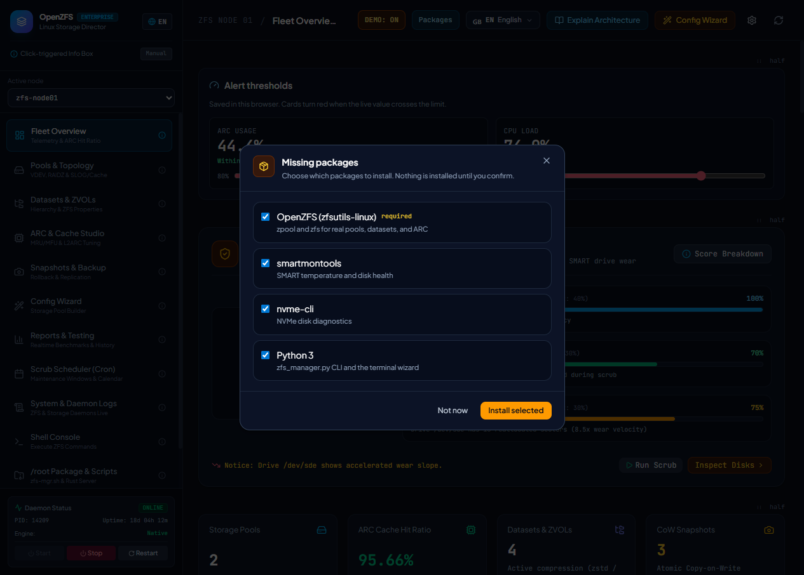

4. Check the **Active node** selector at the top of the sidebar. It shows the local hostname by default. Every pool, dataset, snapshot, disk, and ARC action targets the node selected here.
5. Open the **Dashboard** and confirm that your pools and disks are listed.

The screenshots in this manual were taken in DEMO mode with the English UI, so the pools and disks are the simulated ones from `zfs_state.json`.

### 5.2 Interface layout

**Sidebar (left)**

- Brand bar with a quick language toggle.
- **Click-triggered Info Box**: when set to *On*, clicking a menu entry also opens that page's explanation dialog. *Manual* opens it only when you click the `i` icon next to the entry.
- **Active node** selector: local host plus every registered SSH node.
- Navigation: Fleet Overview (dashboard), Pools & Topology, Datasets & ZVOLs, ARC & Cache Studio, Snapshots & Backup, Config Wizard, Reports & Testing, Scrub Scheduler, System & Daemon Logs, Shell Console, /root Package & Scripts (deployment), SSH nodes.
- **Daemon status** box with PID, uptime, and Start/Stop/Restart buttons. In LIVE mode the panel *is* the service, so these buttons report status and do not stop the process. Use `./zfs-mgr.sh` on the host to stop or restart it.

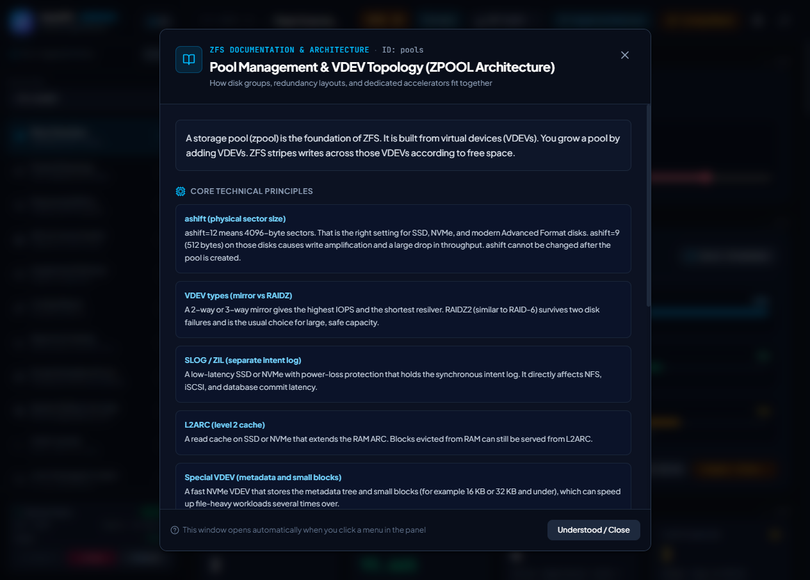

**Header (top)**

- Mode badge (**LIVE** / **DEMO: ON**): click to switch.
- **Packages**: host package status and installer.
- Language menu (8 languages; English is the default and Albanian is listed last).
- **Explain Architecture**: opens the info dialog for the current page.
- **Config Wizard**: jumps to the pool creation wizard.
- **Settings** (gear icon): telemetry Web Worker and `requestAnimationFrame` rendering, SMART desktop notifications, language, and info-box auto-open.
- **Refresh**: reloads pools, datasets, snapshots, and ARC from the active node.

On screens narrower than a laptop, the sidebar opens from the menu button in the header.

| Settings, performance tab | Settings, General tab (languages) |
| --- | --- |
| 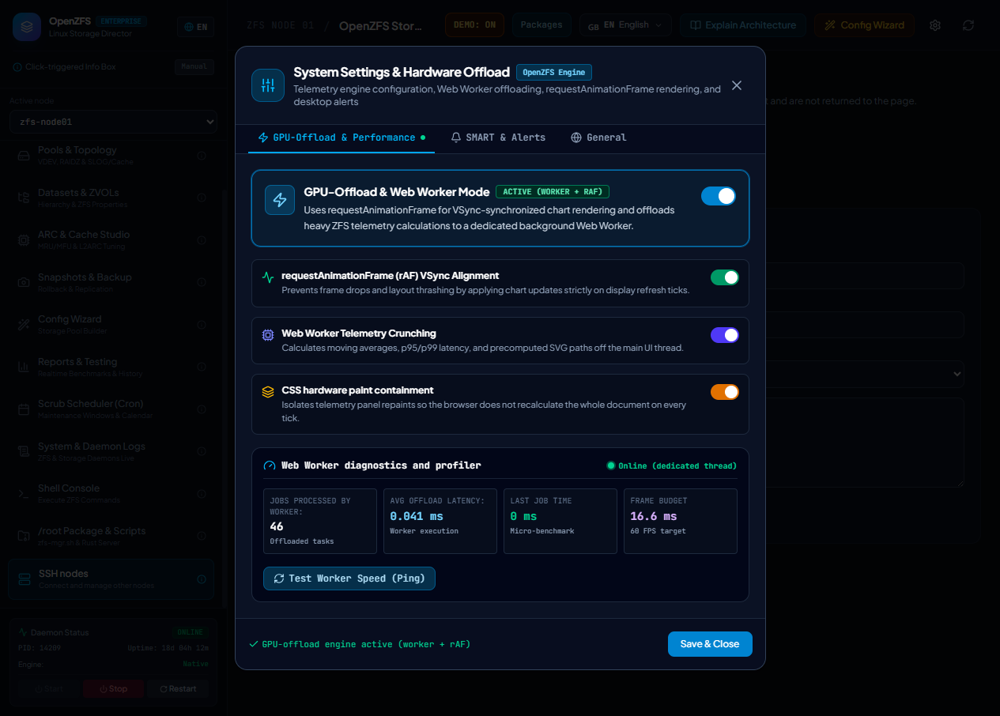 | 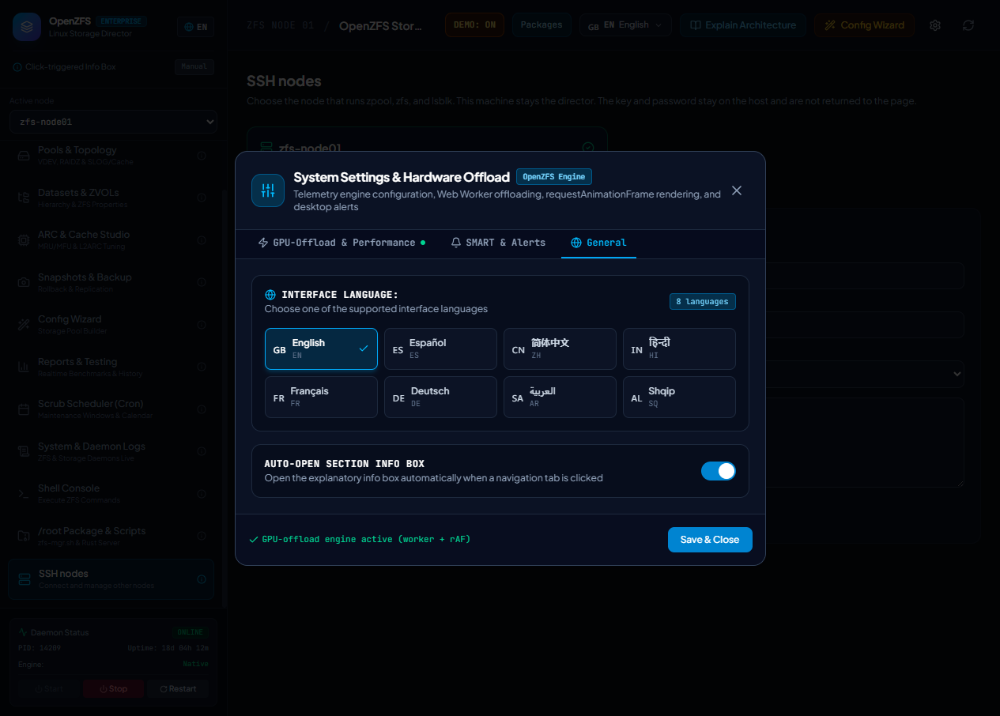 |

### 5.3 Dashboard

Pool health and capacity, host CPU and memory charts, ARC hit ratio, alert thresholds, a drive health summary, and the disk list from `lsblk`. Charts that have no real measurement on the host stay empty instead of showing invented values. CPU and memory always describe the machine running the panel, even when a remote node is active.

Click a disk to open its device dialog with `smartctl` data. If the disk reports no SMART data, the dialog says it was not measured.

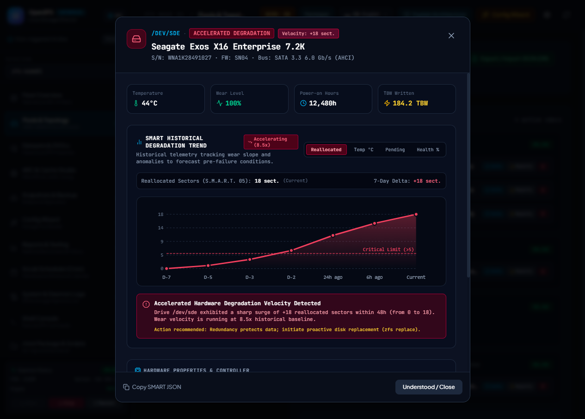

### 5.4 Pools

Select a pool from the list to see its vdev tree, health, scrub status, and capacity. Each disk has **Info** (the SMART dialog above), **Modify** (offline or online), and a remove button.

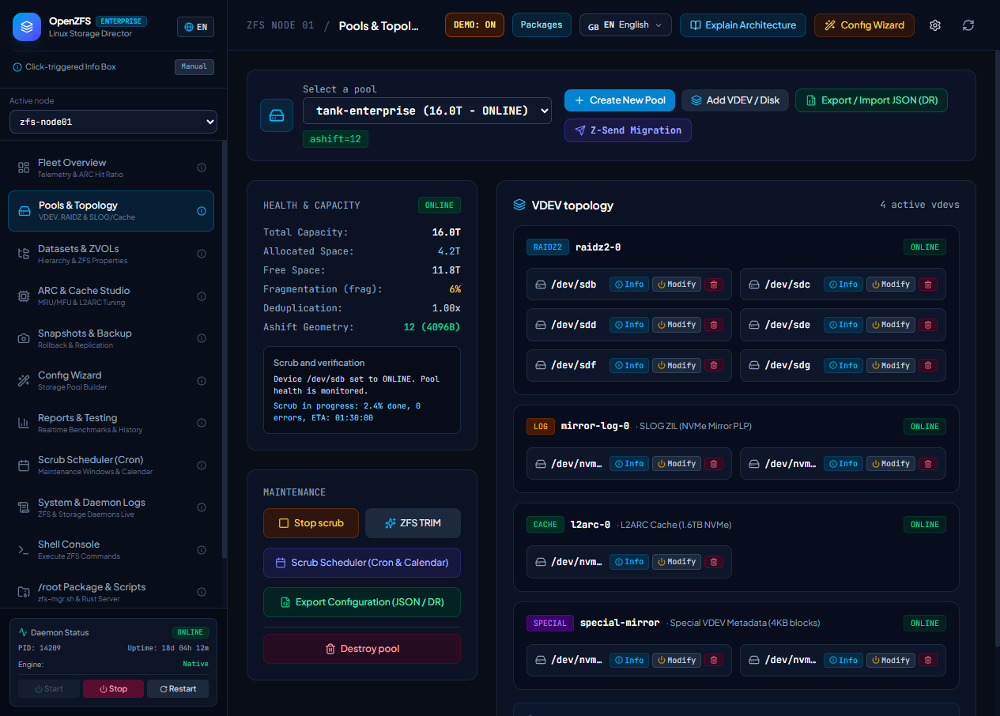

| Action | How | Command on the node |
| --- | --- | --- |
| Start, pause, or stop a scrub | Scrub controls on the pool card | `zpool scrub`, `zpool scrub -p`, `zpool scrub -s` |
| TRIM | **Run TRIM** | `zpool trim <pool>` |
| Add a vdev | **Add VDEV / Disk**, choose the role and disks | `zpool add <pool> log|cache|special|spare [mirror] <disks>` |
| Take a disk offline or online | Click the disk in the topology, then toggle its state | `zpool offline` / `zpool online` |
| Remove a disk | Click the disk, then remove | `zpool remove <pool> <dev>` |
| Back up the configuration | Backup / export dialog, export one pool or all pools | Reads the live inventory and downloads JSON |
| Destroy | **Destroy pool**, then type `YES` or `CONFIRM` | `zpool destroy <pool>` |

In LIVE mode **Add VDEV** accepts log (SLOG), cache (L2ARC), special, and spare roles. Two or more log or special disks are added as a mirror. Adding data vdevs (mirror or raidz) to an existing pool is not offered in LIVE; do it from the shell with `zpool add` after checking the layout.

| Add VDEV dialog | Destroy confirmation |
| --- | --- |
| 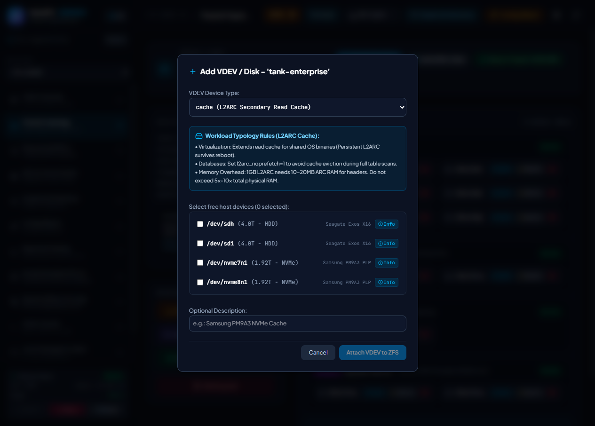 | 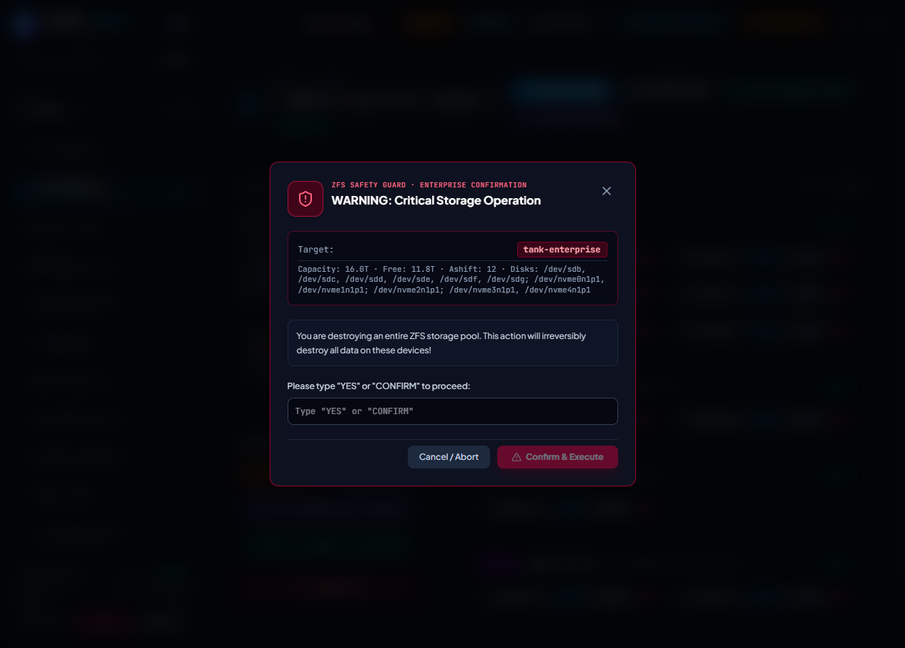 |

The exported JSON includes the pool topology, datasets, snapshots, and a `reconstructedCommands` section with the `zpool create` and `zfs create` lines that would rebuild the layout. **Importing** such a file from the panel builds a simulated pool and only works in DEMO.

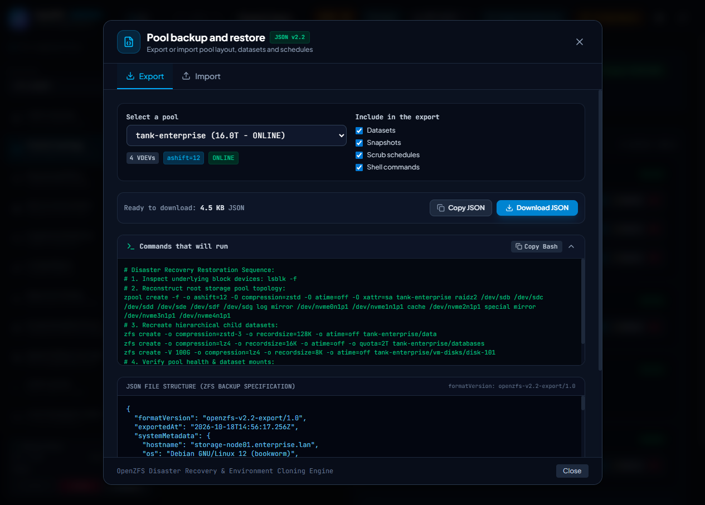

### 5.5 Datasets

- **Create**: enter the full name (`pool/parent/name`), choose *filesystem* or *volume*. Filesystems accept compression (`off`, `lz4`, `zstd`, `zstd-1`..`zstd-9`, `gzip`, `gzip-1`..`gzip-9`), recordsize (`512` to `1M`), atime (`on`/`off`), and an optional quota such as `500G`. Volumes need a size such as `50G`.
- **Edit properties**: compression, recordsize, quota, atime, dedup, readonly, and mountpoint. Each change runs `zfs set <property>=<value> <dataset>`.
- **Destroy**: runs `zfs destroy <dataset>` without `-r`. ZFS refuses if the dataset has children or snapshots; remove those first.

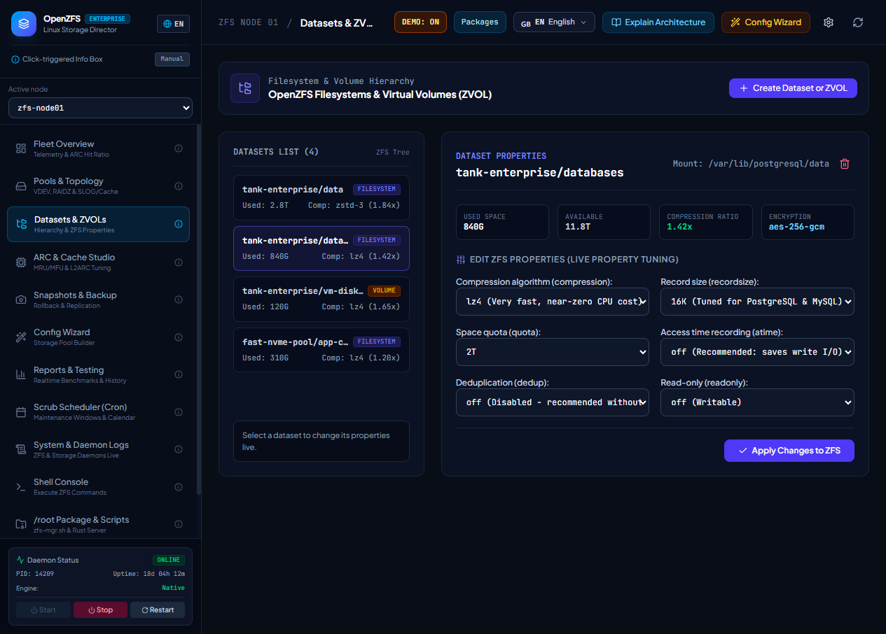

### 5.6 ARC

Shows ARC size, target min and max (`c_min`, `c_max`), hit ratio, MRU and MFU, data and metadata split, and L2ARC size and hit ratio, read from `/proc/spl/kstat/zfs/arcstats` on the active node.

1. **Apply (runtime)**: writes `zfs_arc_max`, `zfs_arc_min`, `l2arc_write_max`, and `l2arc_noprefetch` to `/sys/module/zfs/parameters/`. Takes effect immediately and is lost on reboot. Works on the local node and on a remote node.
2. **Persist**: writes the same values to `/etc/modprobe.d/zfs.conf`, after copying the old file and the current initrd, then runs `update-initramfs -u`. Persist is refused in DEMO and when a remote node is active; it only runs on the director host.

Values are in bytes. For example, 8 GiB is `8589934592` and 32 GiB is `34359738368`.

The **Workload profiles** section (OLTP & SQL, Hypervisors & ZVOL, NFS / SMB / 4K Video, Standard) suggests special vdev, SLOG, L2ARC, and ARC sizes for each workload. **Apply this profile** fills the tuner sliders; nothing is written until you apply or persist.

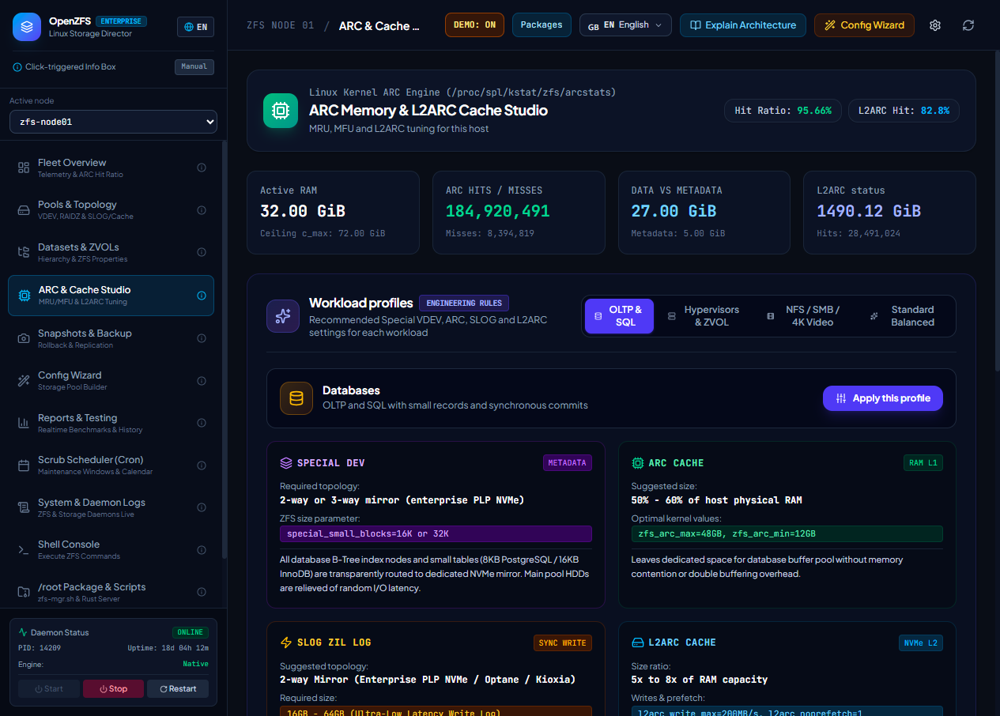

### 5.7 Snapshots

- **Create**: choose a dataset and a snapshot name (letters, numbers, `_ . : -`). Runs `zfs snapshot <dataset>@<name>`.
- **Roll back**: confirm in the dialog. Runs `zfs rollback <snapshot>` without `-r`, so ZFS refuses when newer snapshots exist instead of deleting them. Roll back to the latest snapshot, or delete the newer ones yourself first.
- **Destroy**: runs `zfs destroy <dataset>@<name>`.
- **Migrate (Z-Send)**: the migration dialog shows the `zfs send | zfs receive` command for the selected snapshot and simulates the transfer. It only runs in DEMO. In LIVE, use the command from the shell, for example:

```bash
zfs send -c -p tank/data@snap1 | zfs receive -F backup/data
```

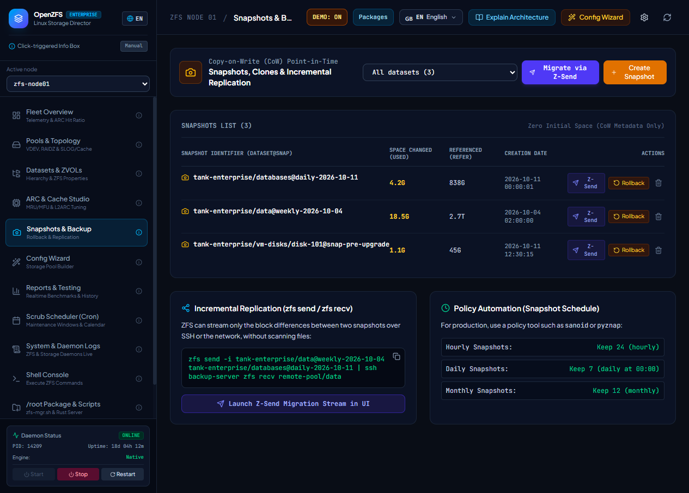

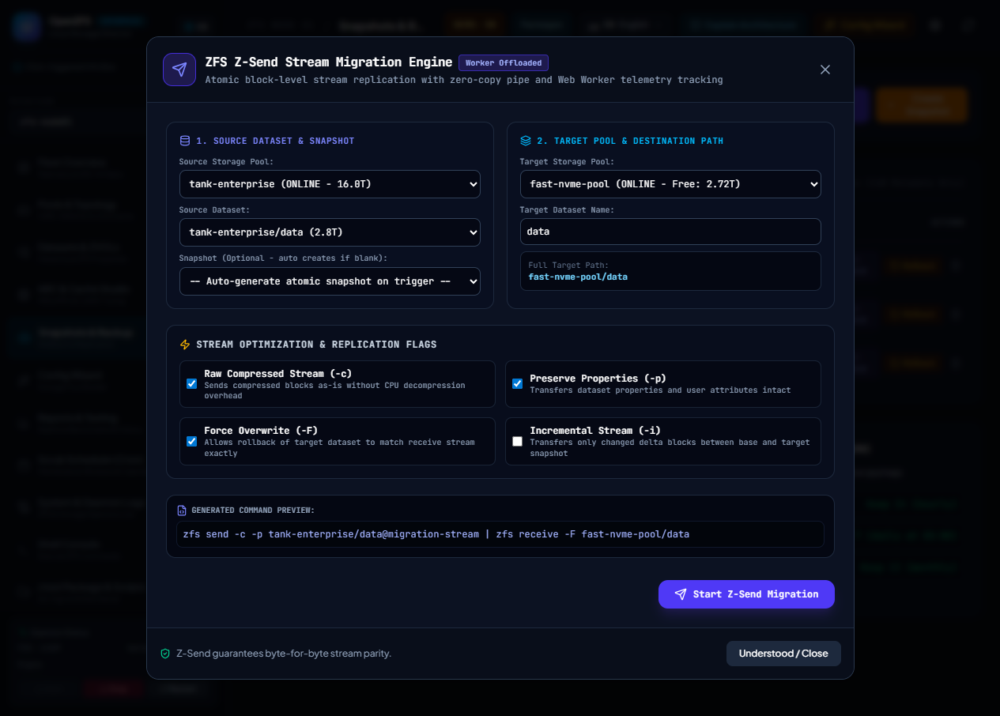

### 5.8 Wizard

Creates a new pool in five steps:

1. **Pool name and ashift** (12 for 4K-sector disks, the usual choice).
2. **Topology and disks**: stripe, 2-way mirror, 3-way mirror, raidz1, raidz2, raidz3, draid1, draid2, or draid3, then the data disks. Disks already in a pool and the system disk are disabled, with the reason shown. Minimum disk counts: stripe 1, mirror 2, 3-way mirror 3, raidz1 and draid1 3, raidz2 and draid2 4, raidz3 and draid3 5.
3. **Flash acceleration and extra roles** (optional): SLOG (ZIL), L2ARC, special, spare. A disk can only have one role.
4. **Filesystem properties**: compression, recordsize, and a workload preset.
5. **Command review**: check the generated `zpool create` command, then deploy.

The pool is created with `-o ashift=<n> -O compression=<c> -O atime=off -O xattr=sa -O acltype=posixacl -O recordsize=<r>`.

| Step 1: name and ashift | Step 2: topology and disks | Step 5: command review |
| --- | --- | --- |
| 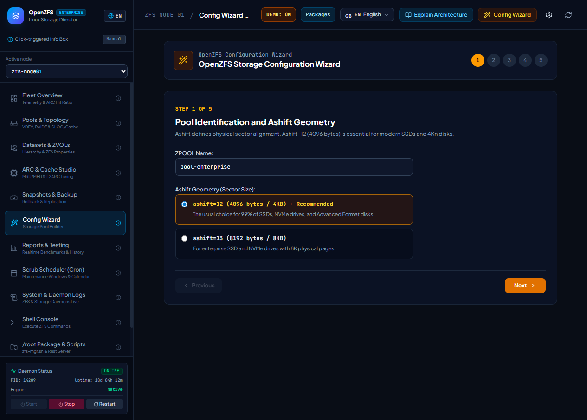 | 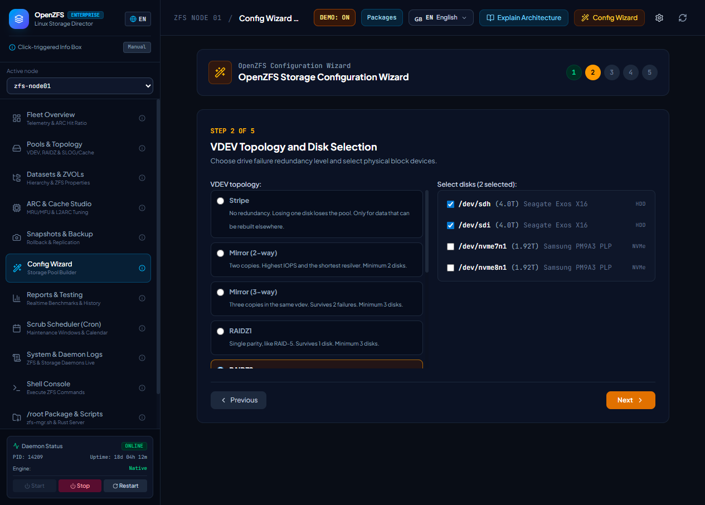 | 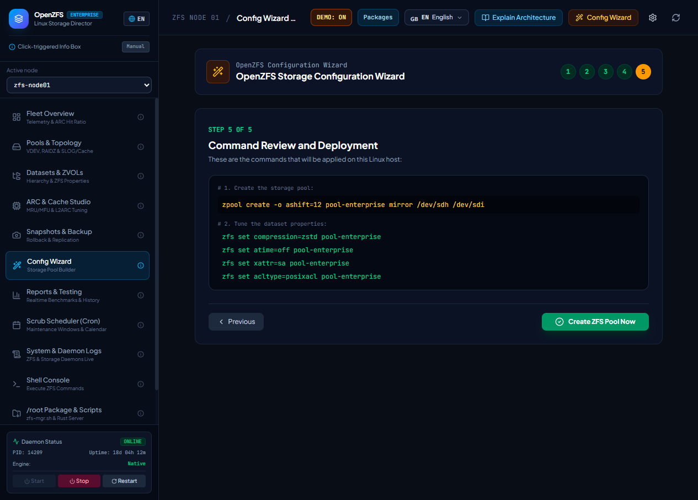 |

### 5.9 Reports

Host I/O and resource-usage charts from the telemetry endpoints, plus benchmark history and report export. **Run Performance Benchmark** produces simulated results and only works in DEMO; in LIVE use a real tool such as `fio` on the pool.

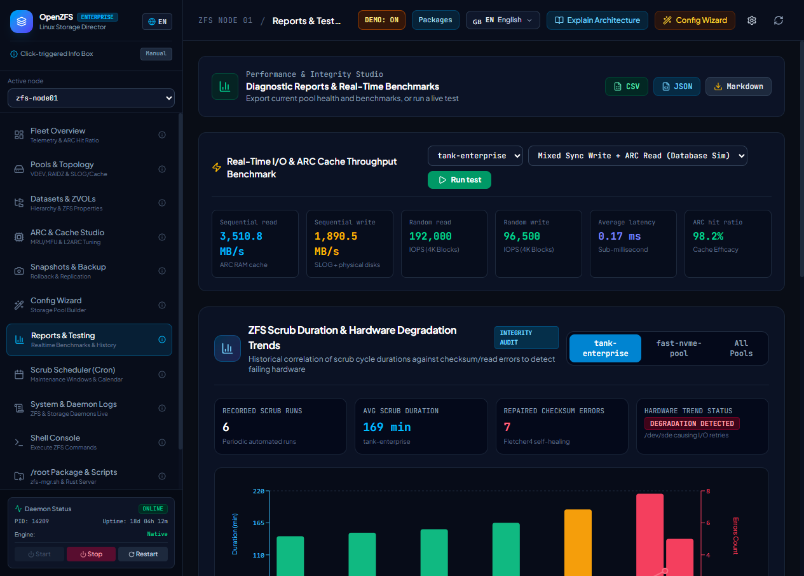

### 5.10 Scheduler

Scrub schedules (weekly, every two weeks, monthly, or a custom cron expression), with a maintenance window, priority, and run-now or pause buttons.

Schedules are stored in the DEMO state file. In LIVE mode the page shows no schedules and refuses to save, because nothing on the host would execute them. Schedule real scrubs with cron or systemd instead (see [Schedule a weekly scrub](#65-schedule-a-weekly-scrub-live)).

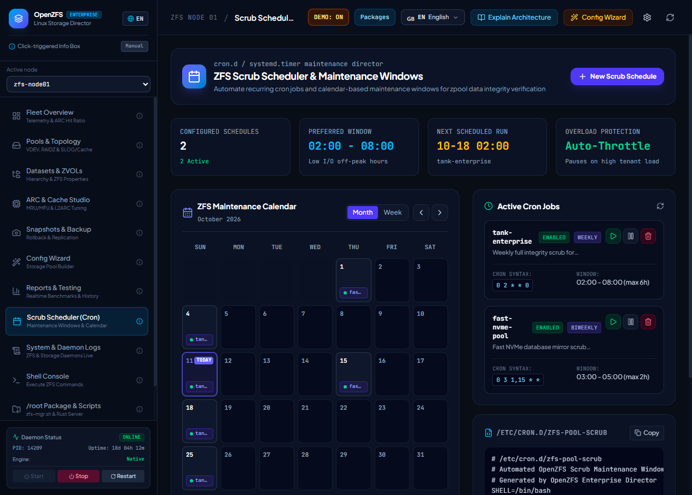

### 5.11 Logs

Filters by level, source, pool, and text, with a clear button. The log buffer belongs to DEMO mode; in LIVE the list is empty. For real logs use:

```bash
sudo zpool events -v
sudo journalctl -u zfs-zed --since today
tail -f /var/log/zfs-enterprise-director.log
```

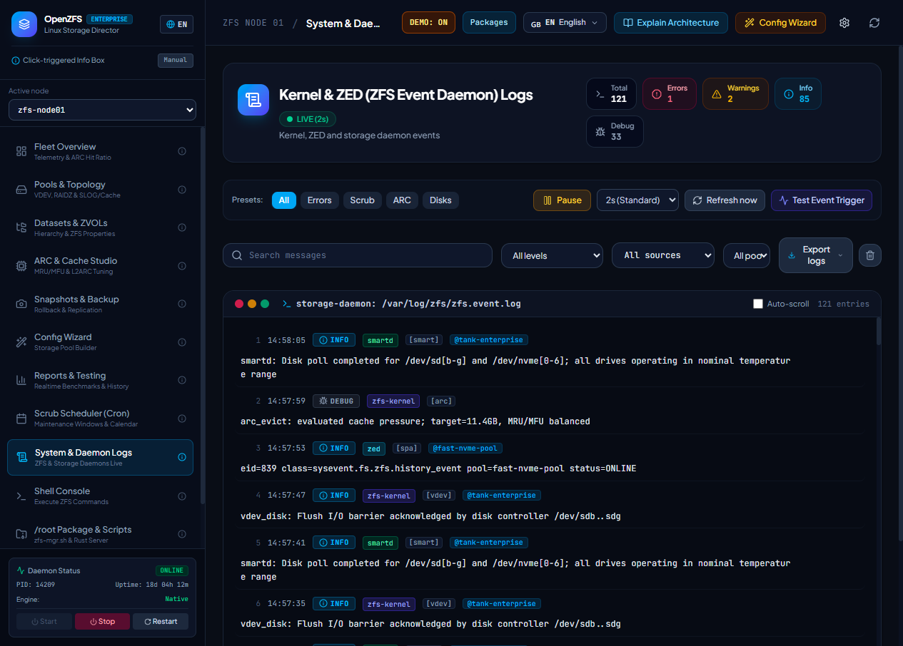

### 5.12 Terminal

Runs one command on the active node and prints the output. In LIVE the command must start with `zpool`, `zfs`, `arcstat`, `arc_summary`, or `lsblk`, and must not contain shell operators (`; & | $ < > \` or backticks). Examples:

```text
zpool status -v
zpool list -v
zfs list -o name,used,avail,compressratio
zfs get compression,recordsize tank/data
lsblk -o NAME,SIZE,MODEL,SERIAL
```

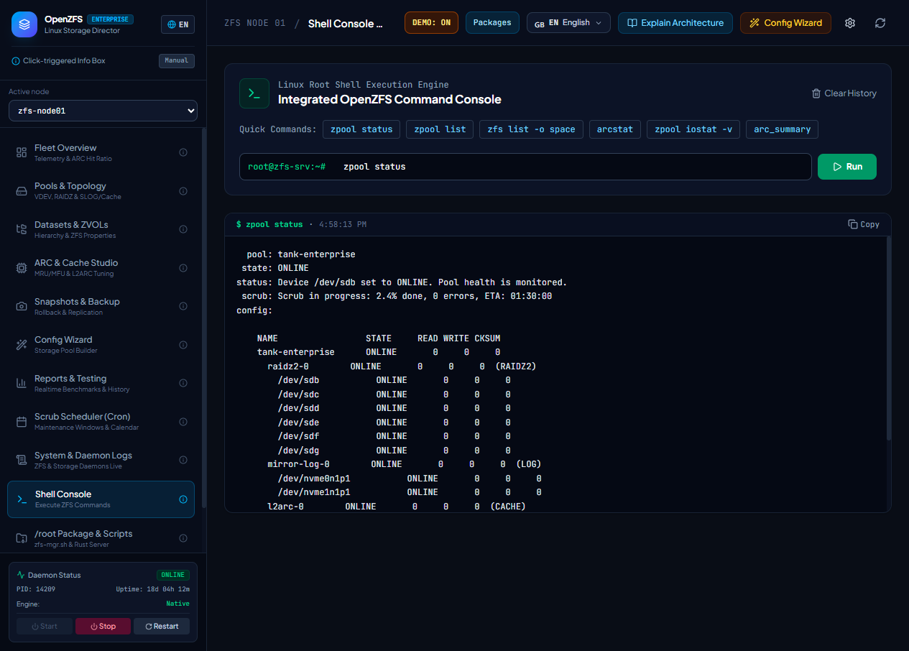

### 5.13 Deployment

Shows the install, start, and CLI steps for a Linux server, and the source of `zfs-mgr.sh`, `zfs_manager.py`, the Rust engine `main.rs`, `install.sh`, and the systemd unit, each with a copy button. Missing packages are installed from the **Packages** dialog.

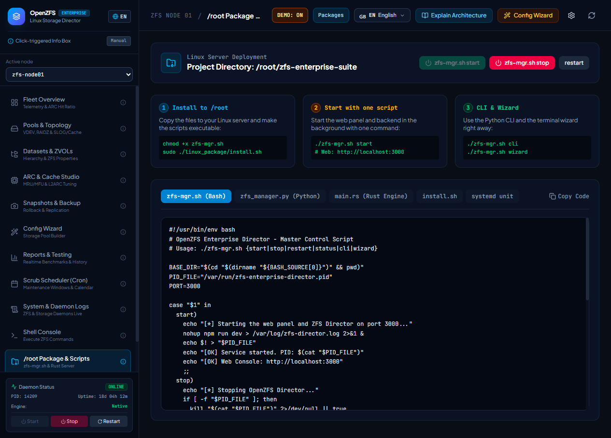

### 5.14 SSH nodes

1. Open **SSH nodes** and click add.
2. Enter a name, hostname or IPv4 address, SSH user, and port (22 by default).
3. Choose authentication:
   - Paste a private key (stored in `/var/lib/zfs-director/keys/`), or
   - Give the path of an existing key under `/root/.ssh/`, or
   - Enter a password.
4. Click **Test**. The panel runs `hostname` and `zpool list` on the node and shows the result.
5. Select the node, here or in the sidebar. From now on, pool, dataset, snapshot, disk, terminal, and ARC actions run on that node, even when DEMO is on.
6. Select the local host again to return. Deleting a node also deletes its stored key.

The SSH user needs to run `zpool` and `zfs` with enough privileges, which in practice means `root` or a user with passwordless `sudo` for those commands.

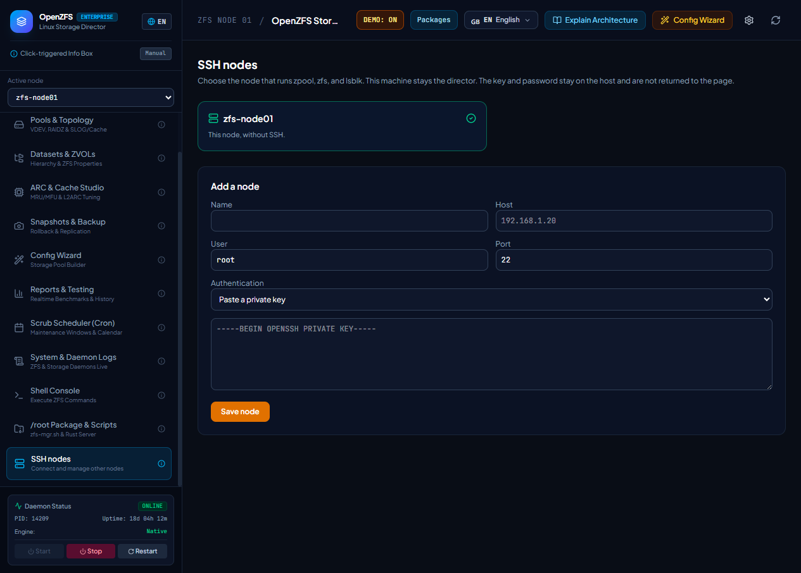

---

## 6. Common tasks

### 6.1 Create the first pool (LIVE)

1. Confirm the header shows **LIVE** and the active node is the right machine.
2. Open **Dashboard** and note the device names of the empty disks (for example `/dev/sdb`, `/dev/sdc`, `/dev/sdd`, `/dev/sde`).
3. Open **Wizard**, enter the name `tank`, keep `ashift=12`, choose `raidz2`, and select the four disks.
4. Optionally add an NVMe partition as SLOG or L2ARC.
5. Choose `zstd` compression and `128K` recordsize, then create.
6. Open **Pools** and check that `tank` is `ONLINE`. In **Terminal**, run `zpool status tank`.

### 6.2 Snapshot before a risky change and roll back

1. **Snapshots**, create `tank/data@before-upgrade`.
2. Make the change.
3. If it went wrong, select `tank/data@before-upgrade` and roll back. If newer snapshots exist, delete them first.

### 6.3 Replace a failing disk

1. **Dashboard**: open the disk and check SMART.
2. **Pools**: click the disk and take it offline.
3. Swap the disk physically.
4. In a shell on the node, run `sudo zpool replace tank /dev/sdX /dev/sdY` (the Terminal page cannot do this; `zpool replace` is run from the host shell).
5. Watch the resilver in **Pools** or with `zpool status tank`.

### 6.4 Limit ARC memory permanently

1. **ARC**: enter `zfs_arc_max=8589934592` (8 GiB) and a lower `zfs_arc_min`, then **Apply**.
2. Check that the hit ratio stays acceptable under normal load.
3. With the local node selected and DEMO off, click **Persist**. The panel backs up `/etc/modprobe.d/zfs.conf` and the initrd, then runs `update-initramfs -u`.
4. After the next reboot, confirm with `cat /sys/module/zfs/parameters/zfs_arc_max`.

### 6.5 Schedule a weekly scrub (LIVE)

Ubuntu's `zfsutils-linux` package already ships a monthly scrub job; check `/etc/cron.d/zfsutils-linux` before adding another. For a weekly scrub every Sunday at 02:00:

```bash
echo '0 2 * * 0 root /usr/sbin/zpool scrub tank' | sudo tee /etc/cron.d/zfs-scrub-tank
```

### 6.6 Manage a second server

1. On the second server, follow [section 3.4](#34-prepare-a-host-that-another-director-will-manage-optional).
2. On the director, add the node on **SSH nodes** and click **Test**.
3. Select the node in the sidebar. All storage pages now show that server.

### 6.7 Keep a recovery copy of the pool layout

**Pools**, open the backup dialog, export all pools, and store the JSON away from the server. To rebuild after a disaster, run the commands from `reconstructedCommands` on new disks, then restore data from your backups or replicas.

### 6.8 Practise safely in DEMO

Click the badge to switch to **DEMO: ON** with the local node selected. Create, destroy, and roll back freely; all changes go to `zfs_state.json`. Switch back to **LIVE** when done.

---

## 7. LIVE and DEMO feature matrix

| Feature | LIVE (local or remote) | DEMO (local) |
| --- | --- | --- |
| Pools: list, create, scrub, trim, destroy | Real `zpool` | Simulated |
| Add log, cache, special, spare vdev | Real `zpool add` | Simulated |
| Add data vdev (mirror, raidz) | Not offered | Simulated |
| Disk offline, online, remove | Real `zpool` | Simulated |
| Datasets and snapshots | Real `zfs` | Simulated |
| ARC runtime tuning | Real sysfs write | Simulated (see [Safety](#12-safety)) |
| ARC persist to `/etc/modprobe.d/zfs.conf` | Local node only | Refused |
| Pool configuration export (JSON) | Live inventory | Simulated inventory |
| Pool configuration import (JSON) | Refused | Simulated |
| Z-Send migration | Refused; use shell | Simulated |
| Scrub schedules | Not stored; use cron | Simulated |
| Benchmark | Refused; use `fio` | Simulated |
| Logs page | Empty; use `journalctl` and `zpool events` | Simulated buffer |
| Terminal | Allow-listed real commands | Canned output |
| SMART | Real `smartctl`, or "not measured" | Real `smartctl` when present |
| CPU and memory charts | Panel host | Panel host |

---

## 8. Command-line tools

### 8.1 `zfs-mgr.sh`

`zfs-mgr.sh` in the project root forwards to `linux_package/zfs-mgr.sh`. Run it with `sudo` for actions that need root.

| Command | What it does |
| --- | --- |
| `./zfs-mgr.sh start` | Starts the panel in the background on port 3000. Uses `server.cjs` when present, otherwise `npm start`. Writes the PID and log files. |
| `./zfs-mgr.sh stop` | Stops the recorded PID and anything still listening on port 3000. |
| `./zfs-mgr.sh restart` | Stop, then start. |
| `./zfs-mgr.sh status` | `AKTIV` with PID and loaded ZFS modules, or `JO AKTIV` with the start command. |
| `./zfs-mgr.sh device /dev/sdX` | `smartctl -x` for the device (defaults to `/dev/sdb`). Without `smartctl` it prints placeholder text, not a real measurement. |
| `./zfs-mgr.sh test` | Prints fixed sample benchmark figures. It does not measure the host. |
| `./zfs-mgr.sh cli …` | Python CLI, see below. |
| `./zfs-mgr.sh wizard` | Interactive terminal wizard, see below. |
| `./zfs-mgr.sh web-rust` | Builds and runs `linux_package/rust_engine` when `cargo` is installed; otherwise starts the Node panel. |
| `./zfs-mgr.sh help` | Usage summary. |

### 8.2 Python CLI

```bash
./zfs-mgr.sh cli pool list
./zfs-mgr.sh cli pool status [pool]
./zfs-mgr.sh cli arc status
sudo ./zfs-mgr.sh cli arc tune --max 8589934592
sudo ./zfs-mgr.sh cli scrub <pool> --action start|stop|pause
```

The CLI ignores the panel's DEMO switch. When `zpool` is installed it calls the real `zpool`; when it is not, it reads and writes `zfs_state.json`. `arc tune` writes `/sys/module/zfs/parameters/zfs_arc_max` when that file exists and prints the matching `/etc/modprobe.d/zfs.conf` line for a permanent setting.

### 8.3 Terminal wizard

```bash
./zfs-mgr.sh wizard
```

Asks for pool name, ashift, topology, compression, SLOG, and L2ARC, then prints the `zpool create` and `zfs set` commands and saves the answers to `/etc/zfs-director/wizard_profile.json`. It does not run the commands, and the printed disk names (`/dev/sdb`..`/dev/sde`, `/dev/nvme*`) are placeholders: replace them with your disks before running anything.

### 8.4 Rust engine (optional)

`linux_package/rust_engine` is a small Axum and Tokio service that reads `/proc/spl/kstat/zfs/arcstats`. It is started only by `./zfs-mgr.sh web-rust` and does not serve the panel.

It serves 4 routes (`/api/zfs/arc/telemetry`, `/api/zfs/devices/:dev`, `/api/zfs/benchmark/run`, `/api/system/packages`) on port 3000, the same port as the panel, so running it in place of `start` leaves the browser with a 404. On the routes both servers share, it is about 9 to 13 times faster and uses 8 to 17 times less memory than the Node panel. See [docs/RUST_ENGINE_BENCHMARK.md](docs/RUST_ENGINE_BENCHMARK.md) for the sandbox measurements and charts.

---

## 9. Architecture

The panel is one Node.js process. It serves the built React page and the `/api` routes. OpenZFS stays on the host or on an SSH node. There is no database.

```text
Browser
  |
  |  HTTP  :3000
  v
Node.js  (Express; server.cjs bundle or server.ts)
  |
  +-- static files in dist/          React 19, Tailwind 4, Recharts
  |
  +-- /api/zfs/*  /api/nodes  /api/system/*
        |
        +-- DEMO, local node     linux_package/python_cli/zfs_state.json
        |
        +-- LIVE, local node     zpool, zfs, lsblk, smartctl, /proc/spl/kstat/zfs
        |
        +-- remote node selected ssh  ->  same commands on that host
```

| Layer | What it is | Role |
| --- | --- | --- |
| Browser | Any modern browser | Renders the panel. Language and UI flags stay in `localStorage`. |
| Web UI | React 19, Vite 8, Tailwind CSS 4, Recharts, a telemetry Web Worker | All pages listed in the user manual. |
| API | Express 4 | JSON under `/api`. Binds `0.0.0.0:$PORT`. |
| Process manager | `zfs-mgr.sh`, `start.sh`, `scripts/serve-light.sh`, optional systemd unit | Start, stop, status, build-on-change. |
| OpenZFS | `zfsutils-linux` on the managed host | Pools, datasets, snapshots, scrub, trim, ARC. |
| Disk identity | `lsblk`, `smartctl`, `nvme` | Disk list and SMART. Missing SMART is reported as not measured. |
| Python CLI | `linux_package/python_cli/` | `zfs-mgr.sh cli` and `zfs-mgr.sh wizard`. |
| Rust service (optional) | `linux_package/rust_engine` | ARC reader started only by `web-rust`. |

Request path:

1. The browser loads `dist/index.html` and calls `/api/...`.
2. The server reads the DEMO flag from `demo_mode.json` and the active node from `/var/lib/zfs-director/nodes.json`.
3. DEMO with the local node: reads and writes go to `zfs_state.json`.
4. LIVE, or a remote node selected: the server runs `zpool`, `zfs`, `lsblk`, and `smartctl` locally or over `ssh`.
5. CPU and memory charts always come from the machine running the panel.

Main API groups:

| Prefix | Purpose |
| --- | --- |
| `/api/zfs/status`, `/api/zfs/pools`, `/api/zfs/pools/:name/{scrub,trim,vdev,export}` | Pools |
| `/api/zfs/datasets`, `/api/zfs/snapshots`, `/api/zfs/snapshots/rollback` | Datasets and snapshots |
| `/api/zfs/arc`, `/api/zfs/arc/tune`, `/api/zfs/arc/persist` | ARC |
| `/api/zfs/devices/:dev`, `/api/zfs/devices/action`, `/api/zfs/drives/*` | Disks and SMART |
| `/api/zfs/telemetry/*`, `/api/zfs/system/hardware` | Charts and hardware |
| `/api/zfs/scrub-schedules`, `/api/zfs/scrub-history`, `/api/zfs/zsend/*`, `/api/zfs/benchmark/run`, `/api/zfs/logs` | DEMO-backed features |
| `/api/zfs/exec` | Terminal |
| `/api/nodes`, `/api/nodes/:id/test`, `/api/nodes/active` | SSH nodes |
| `/api/system/demo`, `/api/system/packages`, `/api/system/packages/install` | Mode and packages |

Source tree:

```text
server.ts                         Express API and static serving (source)
server.cjs                        Prebuilt self-contained bundle used by zfs-mgr.sh and start.sh
src/                              React panel, i18n locales, API client, telemetry worker
dist/                             Built panel, created by Vite
scripts/serve-light.sh            npm start / npm run dev launcher
start.sh                          Portable foreground launcher (node server.cjs)
zfs-mgr.sh                        Wrapper for linux_package/zfs-mgr.sh
linux_package/zfs-mgr.sh          start, stop, status, device, test, cli, wizard, web-rust
linux_package/install.sh          System-wide installer and systemd unit
linux_package/python_cli/         CLI, terminal wizard, DEMO JSON files
linux_package/rust_engine/        Optional Axum service
linux_package/docs/               Installation guide and ZFS architecture manual
```

---

## 10. Development

```bash
npm install
npm start          # build dist/ if sources changed, then serve with a 128 MB heap
npm run dev        # same as npm start
npm run dev:vite   # Vite middleware through tsx; hot reload is disabled
npm run build      # write dist/
npm run lint       # tsc --noEmit
```

`npm start` and `npm run dev` run `scripts/serve-light.sh`: one Vite build when `src/`, `server.ts`, `index.html`, or `vite.config.ts` is newer than `dist/index.html`, then `node --experimental-strip-types --max-old-space-size=128 server.ts`.

`zfs-mgr.sh start` prefers `server.cjs`, which does not include later edits to `server.ts` and does not rebuild `dist/`. While developing, run `npm start` instead, or rebuild `server.cjs` and `dist/` before using `zfs-mgr.sh`.

---

## 11. Troubleshooting

| Symptom | Cause and fix |
| --- | --- |
| `status` prints `JO AKTIV` | The panel is not running. Run `sudo ./zfs-mgr.sh start`. |
| `[GABIM] Node.js nuk eshte i instaluar` | Node.js is missing. Install Node.js 22 (section 3.1). |
| `Deshtoi nisja e serverit` | Start failed. Read `/var/log/zfs-enterprise-director.log`. A common cause is another process on port 3000: `sudo ss -ltnp 'sport = :3000'`. |
| `status` says not running but the page loads | `ss` from `iproute2` is missing, so the script cannot see the listener. Install `iproute2`. |
| Page does not load from another machine | Firewall. `sudo ufw allow 3000/tcp`, and check that the server IP is reachable. |
| Pools page is empty in LIVE | No pools imported, OpenZFS missing, or the module is not loaded. Run `sudo modprobe zfs` and `zpool list`. |
| Actions fail with permission errors | The panel is not running as root. Restart it with `sudo ./zfs-mgr.sh start`. |
| SMART shows "not measured" | `smartmontools` is missing, or the disk (often a virtual disk) has no SMART. Install `smartmontools`; virtual disks will stay unmeasured. |
| Wizard disables a disk | The disk is part of a pool or holds the system. The reason is shown next to it. |
| Pool create fails with "needs at least N disks" | The topology needs more disks; see the minimums in section 5.8. |
| SSH node test fails | Check host, port, user, and key from the director: `ssh -p <port> <user>@<host> zpool list`. Make sure `zfsutils-linux` is installed on the node. |
| ARC Persist refused | DEMO is on, or a remote node is active. Switch to LIVE and select the local node. |
| `update-initramfs failed` after Persist | The new `zfs.conf` was written; the old one and the initrd were backed up. Fix the reported error and run `sudo update-initramfs -u`, or restore the `.bak-*` files. |
| Scheduler, Logs, or Reports empty in LIVE | Expected; these features are DEMO-backed. See sections 5.9 to 5.11. |
| UI does not show recent code changes | `zfs-mgr.sh` serves `server.cjs` and the existing `dist/`. Use `npm start` while developing (section 10). |

---

## 12. Safety

- In LIVE mode, pool destroy, dataset destroy, snapshot destroy, rollback, disk offline and remove, and `zpool add` change real storage immediately. `zpool add` cannot be undone for most vdev types.
- Check the header badge and the active node before every destructive action. A selected remote node makes actions real even when DEMO is on.
- ARC persist rewrites `/etc/modprobe.d/zfs.conf` and the initramfs. Backups are made first; keep them until the host has rebooted cleanly.
- In DEMO with the local node, **Apply** on the ARC page also tries to write `zfs_arc_max` to `/sys/module/zfs/parameters/` when the panel runs as root on a host with ZFS loaded. That value is runtime only and resets on reboot.
- Never select the system disk in the wizard. The wizard disables it, but double-check device names on unusual hardware.
- The panel has no authentication. Restrict port 3000 to a trusted network.
- Keep SSH private keys out of the git repository. They belong only in `/var/lib/zfs-director/keys/` (or `/root/.ssh/`) on the director host.
- Snapshots are not backups. Replicate important datasets to another pool or host with `zfs send` and `zfs receive`.
