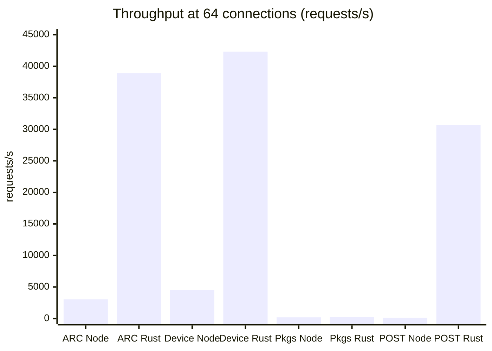
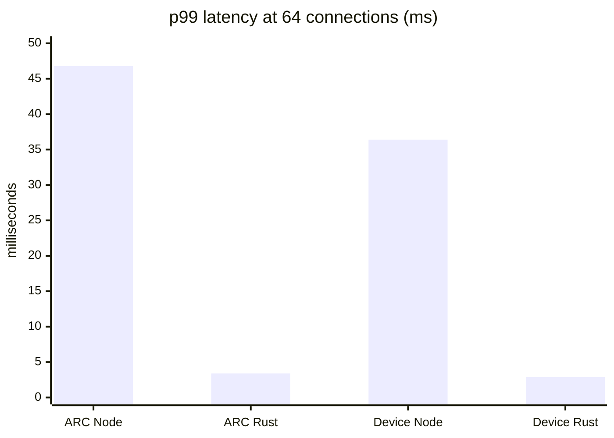
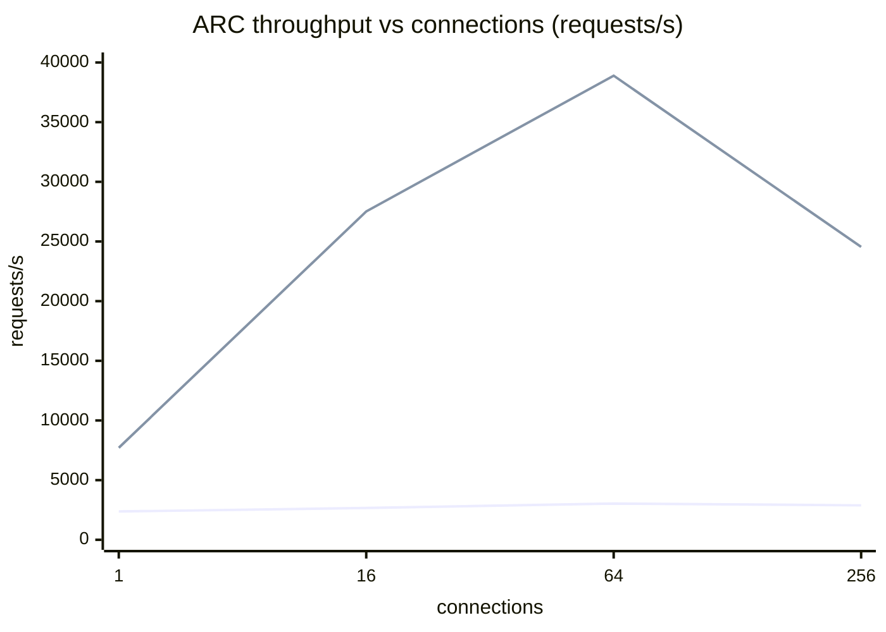
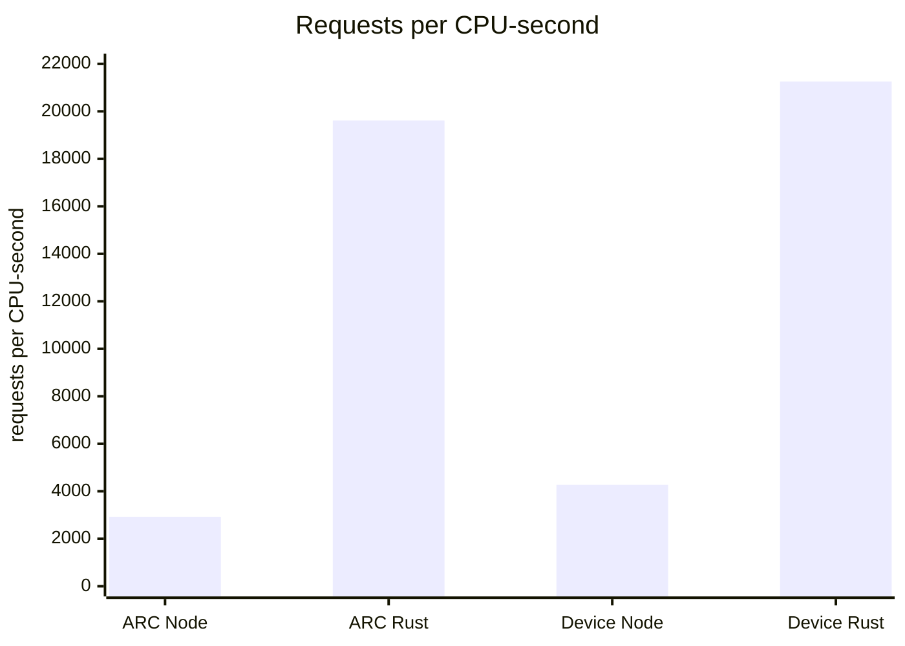
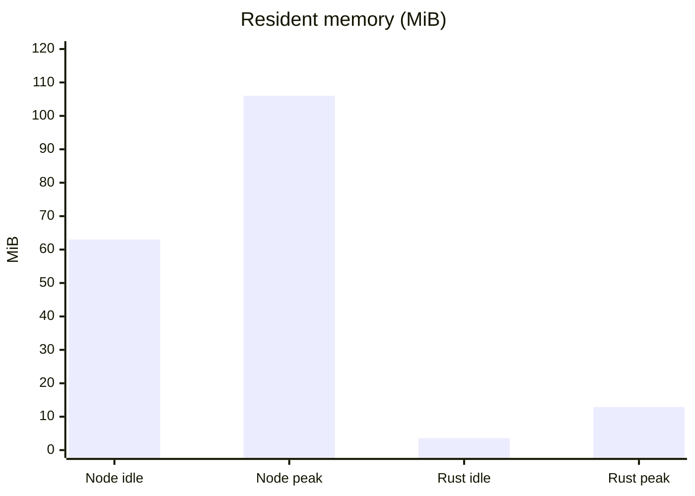
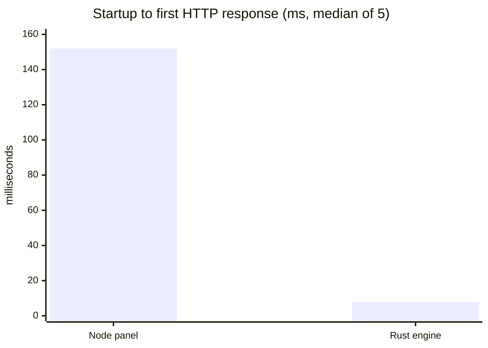

# Benchmark: panel with and without `rust_engine`

This report compares the two HTTP servers shipped in this repository, running in the same sandbox under the same limits:

- **Without `rust_engine`**: the Node.js panel (`server.cjs`, Express). This is what `./zfs-mgr.sh start` runs.
- **With `rust_engine`**: the Axum/Tokio service in `linux_package/rust_engine`. This is what `./zfs-mgr.sh web-rust` runs.

Date of the run: 18 October 2026. Raw data is in [`benchmark/results/`](benchmark/results/), and the scripts to repeat the run are in [`benchmark/`](benchmark/).

## Contents

1. [Summary](#1-summary)
2. [Sandbox and method](#2-sandbox-and-method)
3. [Functional coverage](#3-functional-coverage)
4. [Throughput](#4-throughput)
5. [Latency](#5-latency)
6. [Concurrency](#6-concurrency)
7. [CPU efficiency](#7-cpu-efficiency)
8. [Memory and startup](#8-memory-and-startup)
9. [Build and footprint](#9-build-and-footprint)
10. [Findings](#10-findings)
11. [Reproducing the run](#11-reproducing-the-run)

---

## 1. Summary

| Metric | Node panel (without Rust) | Rust engine (with Rust) | Rust vs Node |
| --- | ---: | ---: | ---: |
| API routes served | 58 + web UI | 4, no UI | 7% of the routes |
| ARC endpoint, requests/s (64 connections) | 3,042 | 38,895 | 12.8x |
| ARC endpoint, p99 latency | 46.8 ms | 3.4 ms | 13.7x lower |
| Device endpoint, requests/s | 4,509 | 42,310 | 9.4x |
| Packages endpoint, requests/s | 184 | 249 | 1.35x |
| Startup to first response (median of 5) | 152 ms | 8 ms | 19x faster |
| Memory at idle (RSS) | 63.0 MiB | 3.6 MiB | 17x less |
| Peak memory under load | 106.0 MiB | 12.9 MiB | 8.2x less |
| Deployed size | 127.8 MB (Node runtime + bundle + UI) | 2.1 MB binary | 60x smaller |

On the routes they share, the Rust engine is about an order of magnitude faster and uses far less memory. But it implements only 4 of the panel's routes, serves no web page, and uses a different path and response shape for ARC data. It cannot replace the panel today. Section 10 covers what this means in practice.

## 2. Sandbox and method

| Item | Value |
| --- | --- |
| Host | Intel Core i5-10310U @ 1.70 GHz, 8 logical CPUs, 15 GiB RAM |
| Sandbox | WSL2 kernel 6.6.114.1, Fedora 40, Podman 5.3.1 (rootful) |
| Node image | `node:22-bookworm-slim`, Node v22.23.3, plus `wrk` 4.1.0 and `curl` |
| Rust toolchain | `rust:1-slim-bookworm`, rustc 1.99.1, release profile |
| Server limits | One container per server, pinned to CPUs 0-1 (`--cpuset-cpus 0-1`), 1 GiB memory |
| Load generator | `wrk` in a separate container pinned to CPUs 4-7, host network |
| Load per test | 5 s warm-up (discarded), then 15 s measured with `--latency` |
| Default load | 4 threads, 64 keep-alive connections |
| Node mode | DEMO on (`demo_mode.json` set to `true` in the sandbox copy only) |

The Node panel reads `linux_package/python_cli/zfs_state.json` on every request. Before each Node run the file was reset to the committed version. The Rust engine falls back to built-in sample values because the sandbox has no `/proc/spl/kstat/zfs/arcstats`. Both servers therefore return demo data, and neither touches a real pool.

The equivalent endpoints compared:

| Test | Node panel | Rust engine | What the server does |
| --- | --- | --- | --- |
| ARC | `GET /api/zfs/arc` | `GET /api/zfs/arc/telemetry` | Node parses the state file; Rust checks for arcstats and returns defaults |
| Device | `GET /api/zfs/devices/sdb` | `GET /api/zfs/devices/sdb` | Builds a SMART info object |
| Packages | `GET /api/system/packages` | `GET /api/system/packages` | Spawns `sh -c "command -v ..."` for each package |
| Benchmark | `POST /api/zfs/benchmark/run` | `POST /api/zfs/benchmark/run` | Node appends a result and rewrites the state file; Rust returns a constant |

CPU time is read from `/proc/<pid>/stat` (user + system, including waited-for child processes) before and after each measured run. Memory is `VmRSS` and `VmHWM` from `/proc/<pid>/status`.

## 3. Functional coverage

| Request | Node panel | Rust engine |
| --- | --- | --- |
| `GET /` (web UI) | 200, panel loads | 404 |
| `GET /api/zfs/arc` (what the UI calls) | 200 | 404 |
| `GET /api/zfs/arc/telemetry` | 404 | 200 |
| `GET /api/zfs/devices/sdb` | 200 (1,252 bytes) | 200 (474 bytes) |
| `GET /api/system/packages` | 200 | 200 |
| `GET /api/zfs/pools` | 200 | 404 |
| `GET /api/zfs/datasets` | 200 | 404 |
| `GET /api/zfs/snapshots` | 200 | 404 |
| `POST /api/zfs/benchmark/run` | 200 | 200 |

The Node panel defines 58 routes. The Rust engine defines 4 and has no static file serving, so a browser pointed at it gets an empty 404.

## 4. Throughput

Requests per second at 64 connections (higher is better). Bars alternate Node, Rust for each endpoint.



| Endpoint | Node req/s | Rust req/s | Rust vs Node |
| --- | ---: | ---: | ---: |
| ARC | 3,042 | 38,895 | 12.8x |
| Device | 4,509 | 42,310 | 9.4x |
| Packages | 184 | 249 | 1.35x |
| Benchmark POST | 116 | 30,672 | 265x (not comparable, see below) |

The packages endpoint is slow on both servers because each request spawns 4 to 8 shell processes. Process creation dominates, so the language barely matters there.

The benchmark POST numbers measure different work. Node appends a result to the state file and rewrites the whole file synchronously; Rust returns a hard-coded object. Section 10 covers the file growth this caused.

## 5. Latency

p99 latency at 64 connections for the two endpoints that do no I/O beyond the state file (lower is better):



| Endpoint | Server | p50 | p90 | p99 | Errors |
| --- | --- | ---: | ---: | ---: | --- |
| ARC | Node | 19.95 ms | 24.99 ms | 46.75 ms | none |
| ARC | Rust | 1.62 ms | 2.39 ms | 3.42 ms | none |
| Device | Node | 13.49 ms | 17.41 ms | 36.43 ms | none |
| Device | Rust | 1.50 ms | 2.17 ms | 2.89 ms | none |
| Packages | Node | 326 ms | 385 ms | 1,280 ms | none |
| Packages | Rust | 255 ms | 359 ms | 464 ms | none |
| Benchmark POST | Node | 412 ms | 1,110 ms | 6,970 ms | 8 timeouts |
| Benchmark POST | Rust | 2.06 ms | 2.98 ms | 4.55 ms | none |

With a single client the gap is small in absolute terms: on ARC the p50 is 0.39 ms for Node and 0.12 ms for Rust. A person using the panel will not notice either.

## 6. Concurrency

Throughput on the ARC endpoint as the number of connections grows. The lower line is Node; the upper line is Rust.



| Connections | Node req/s | Node p99 | Rust req/s | Rust p99 |
| ---: | ---: | ---: | ---: | ---: |
| 1 | 2,371 | 1.19 ms | 7,715 | 0.32 ms |
| 16 | 2,667 | 22.51 ms | 27,520 | 1.88 ms |
| 64 | 3,042 | 46.75 ms | 38,895 | 3.42 ms |
| 256 | 2,887 | 5,290 ms | 24,544 | 45.66 ms |

Node stays flat at about 3,000 requests/s because one event loop does all the work. At 256 connections its p99 climbs past 5 seconds as requests queue. Rust spreads the work over both CPUs and peaks around 64 connections.

## 7. CPU efficiency

Requests served per CPU-second (higher is better):



| Endpoint | Node | Rust | Rust vs Node |
| --- | ---: | ---: | ---: |
| ARC | 2,926 | 19,616 | 6.7x |
| Device | 4,271 | 21,254 | 5.0x |
| Packages | 133 | 156 | 1.17x |

Under load Node used about 1 CPU core (one event loop) and Rust used both of the cores it was given. Part of Rust's throughput lead comes from using the second core. The rest, about 5 to 7 times on these endpoints, comes from doing less work per request.

## 8. Memory and startup





| Server | Startup (5 runs) | Idle RSS | RSS after GET load | Peak RSS (HWM) |
| --- | --- | ---: | ---: | ---: |
| Node | 310, 152, 150, 141, 170 ms | 63.0 MiB | 99.7 MiB | 106.0 MiB |
| Rust | 9, 9, 7, 8, 8 ms | 3.6 MiB | 12.9 MiB | 12.9 MiB |

Startup is measured from process launch to the first successful `GET /api/zfs/devices/sdb`. Node's first run (310 ms) was a cold page cache.

## 9. Build and footprint

| Item | Node panel | Rust engine |
| --- | --- | --- |
| Runtime needed on the server | Node.js binary, 124.8 MB | none |
| Application files | `server.cjs` 1.34 MB + `dist/` 1.58 MB | binary 2.15 MB (1.48 MB stripped) |
| Build | `npm run build` (Vite + esbuild) | `cargo build --release`: 25.7 s clean (65 crates, sources pre-fetched), 3.6 s incremental |
| Build warnings | none | 3 unused-import warnings in `main.rs` |

## 10. Findings

1. **The Rust engine is not an alternative to the panel.** `./zfs-mgr.sh web-rust` runs `cargo run --release` in the foreground on port 3000, the panel's port. Anyone who picks it gets a 4-route JSON API and a 404 in the browser. The README describes it as an optional ARC reader that does not serve the panel, which matches this result.
2. **Raw speed is not the panel's bottleneck.** About 3,000 requests/s on one core is far more than a management UI needs; a dashboard polls a few requests per second. Both servers are slow on the same endpoint (`/api/system/packages`) for the same reason: spawning shell processes. Caching the `command -v` results would help either server more than switching languages.
3. **The Node benchmark route grows the state file without limit.** Each `POST /api/zfs/benchmark/run` adds an entry to `state.benchmarks` and rewrites `zfs_state.json` synchronously. During the 20-second POST test the file grew from 13.5 KB to 1.26 MB. Throughput fell to 116 requests/s with 8 timeouts, because every request now reads and writes a bigger file. A cap on the list (for example the last 50 results) would fix this.
4. **ARC data uses different contracts.** Node serves `GET /api/zfs/arc` as `{ "arc": { ... } }` from the state file (or live kstat when DEMO is off). Rust serves `GET /api/zfs/arc/telemetry` as a flat object with `_bytes` fields. The UI only knows the Node format.
5. **Where Rust would pay off.** If the Rust engine implemented the full API and served `dist/`, it would cut memory by about 8 to 17 times and remove the 125 MB Node runtime dependency. That matters for small appliances, not for throughput.

## 11. Reproducing the run

Requirements: a Linux host or WSL2 distribution with Podman (or Docker with the `podman` commands swapped), run as root.

```bash
npm run build                                  # refresh server.cjs and dist/
sh docs/benchmark/setup.sh                     # copies the inputs to /root/oed-bench
bash /root/oed-bench/build.sh                  # builds the bench image and the Rust binary
bash /root/oed-bench/bench.sh                  # runs the tests (about 8 minutes)
```

Environment variables: `B` sets the work directory for `setup.sh` (default `/root/oed-bench`). `DUR`, `WARM`, and `STARTS` change the test length, warm-up length, and number of startup runs in `bench.sh`.

Output files in `/root/oed-bench/results/`:

| File | Content |
| --- | --- |
| `wrk.csv` | Throughput, latency percentiles, errors, and CPU seconds per test |
| `startup.csv` | Startup time and idle RSS for each run |
| `memory.csv` | RSS and peak RSS at idle, after GET load, and after POST load |
| `coverage.csv` | HTTP status and size of each probed route |
| `build.env` | Build times, binary sizes, and versions |
| `wrk-*.txt` | Full `wrk` output for each test |
